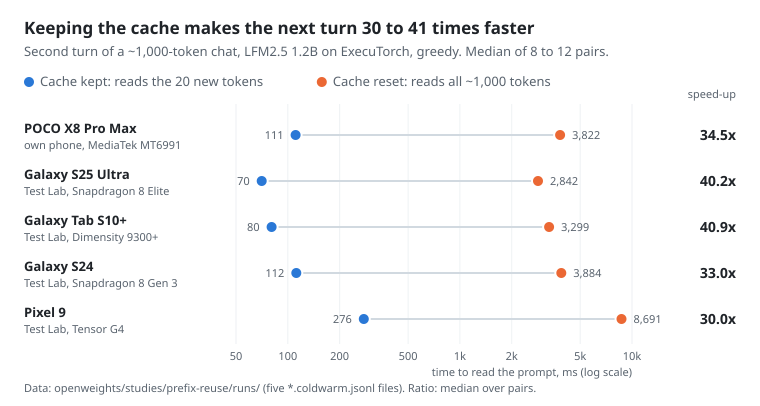
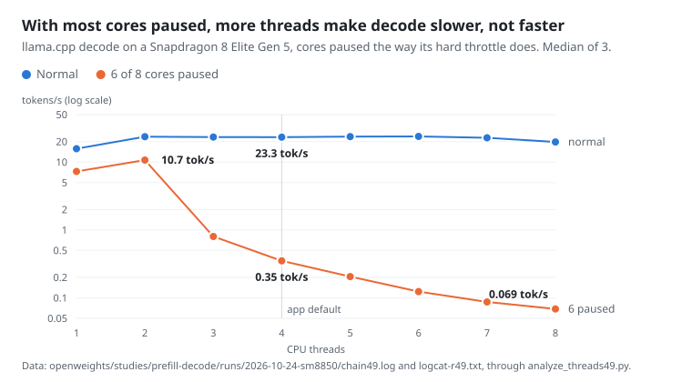

<picture>
  <source media="(prefers-color-scheme: dark)" srcset="figures/banner-dark.svg">
  
</picture>

This repository holds the measurements behind three on-device inference projects by
ExperimentalMachines: what was asked, what the phones said, and the scripts that asked them.
Every number traces back to a run file in this repository, and most runs can be repeated.

| Project | What it is | Here |
|---|---|---|
| [**OpenWeights**](https://github.com/ExperimentalMachines/openweights) | An Android app that runs open-weight chat models entirely on the phone, through llama.cpp and ExecuTorch | [10 studies](openweights/) |
| [**ExecuPack**](https://github.com/ExperimentalMachines/execupack) | A pipeline that compiles those models for a phone's CPU, GPU and NPU, and publishes them | [a 49-finding research log and 6 studies](execupack/) |
| [**ExecuServe**](https://github.com/ExperimentalMachines/execuserve) | An Android app that serves the compiled models to other apps through OpenAI- and Anthropic-compatible endpoints | [5 studies](execuserve/) |

**Jump to:** [What we found](#what-we-found) · [All studies](#all-studies) ·
[Try it without a phone](#try-it-without-a-phone) · [How it is organised](#how-it-is-organised) ·
[Can you trust it?](#can-you-trust-these-numbers) · [Glossary](docs/glossary.md)

## What we found

The findings a developer building on-device inference is most likely to care about. Each links
to the study with the data, the method and the caveats.

1. **Keep the conversation's [cache](docs/glossary.md#kv-cache) between turns.** It made a ~1,000-token second turn start 30
   to 41 times faster on every phone tried (111 ms instead of 3,822 ms on the POCO X8 Pro Max).
   But how the last reply ended decides whether reuse happens at all.
   → [prefix reuse](openweights/studies/prefix-reuse/)
2. **When a phone throttles, fewer threads are faster.** The Snapdragon 8 Elite Gen 5's hard
   [throttle](docs/glossary.md#thermal-throttling) pauses six of its eight CPU cores. With those six paused,
   llama.cpp decoded at 0.35 tokens/s on 4 threads and 10.7 on 2: idle worker threads spin on the
   cores the working ones need.
   → [prefill and decode](openweights/studies/prefill-decode/)
3. **A 4-bit export can silently lose [tool calling](docs/glossary.md#tool-call).** In a one-tool test on a
   Galaxy S25 Ultra, a plainly rounded compiled LFM2.5 1.2B made 10% of the web searches it
   needed, against 51% for the [GGUF](docs/glossary.md#gguf) of the same weights, while its benchmark scores
   barely moved. A [GPTQ](docs/glossary.md#gptq)-solved export in the same format made 49%. (The write-up is
   marked as historical research, not a model approval.)
   → [compiled tool calling](openweights/studies/compiled-tool-calling/)
4. **The [NPU](docs/glossary.md#npu) answers first and writes slowest.** Serving Qwen3 1.7B on a Snapdragon 8
   Elite Gen 5, the NPU's first token after a ~700-token prompt came in 407 ms against the CPU's
   2,039 ms, but after a short 21-token prompt it wrote at 24.8 tokens/s against the CPU's 54.5. A separate
   replay of real multi-turn conversations found that, with cache reuse, the median turn reads only
   50 new tokens, so a faster prompt read rarely pays there.
   → [ExecuServe NPU](execuserve/studies/2026-10-06-npu.md),
   [NPU on real conversations](openweights/harness/README.md#does-npu-prefill-pay-on-real-conversations)
5. **"The GPU is faster" depends on the GPU.** On the POCO's Mali GPU the CPU file decoded 2.2 to
   3.9 times faster than the [Vulkan](docs/glossary.md#vulkan) GPU file; on the Snapdragon 8 Elite Gen 5's Adreno the GPU won
   long prompts. → [Vulkan](openweights/studies/vulkan/)
6. **[Greedy decoding](docs/glossary.md#greedy-decoding) is repeatable on one phone, not across phones.** Over 390 benchmark cases,
   the grade differed between five chips on 13.3% of cases with llama.cpp, and on 31.5% with
   ExecuTorch, though that figure includes runs later found to carry a state leak. → [on-device evals](openweights/studies/on-device-evals/)
7. **Read the fixed prompt head before the user asks.** Pre-filling the instructions and tool
   definitions at load cut a fresh chat's first token from 9,326 ms to 235 ms.
   → [on-device evals](openweights/studies/on-device-evals/)
8. **Vendor sample code can run cleanly and compute the wrong model.** MediaTek's stock Qwen path
   built its rotary embedding at base 10,000 for a model trained at 1,000,000; it ran, and drifted
   from the real model before any quantization. → [ExecuPack research log](execupack/)

<picture>
  <source media="(prefers-color-scheme: dark)" srcset="figures/prefix-reuse-dark.svg">
  
</picture>

<picture>
  <source media="(prefers-color-scheme: dark)" srcset="figures/threads-under-throttle-dark.svg">
  
</picture>

## All studies

### OpenWeights, the Android app

| Study | The question | The short answer |
|---|---|---|
| [Prefix reuse](openweights/studies/prefix-reuse/) | What does keeping the cache save, and when does reuse silently fail? | 30 to 41 times faster second turns; reuse depends on how the last reply ended |
| [Prefill and decode](openweights/studies/prefill-decode/) | Which processor should read the prompt, and which should write the reply? | The NPU reads prompts 10.5 to 15.9 times faster, but writing dominates; under throttling, extra threads are ruinous |
| [On-device evals](openweights/studies/on-device-evals/) | Do both runtimes answer alike on every chip, and how do they score on public benchmarks? | llama.cpp gave identical grades on five chips on the app's seven-case suite, but differed between chips on 13.3% of public-benchmark cases; the GGUF files scored higher on 12 of 14 comparable cells |
| [Retrieve or answer](openweights/studies/retrieve-or-answer/) | When should a small on-phone model search the web? | The compiled model almost never searched; searching when the model's own token probabilities are low doubled correct answers on must-search questions (provisional) |
| [Compiled tool calling](openweights/studies/compiled-tool-calling/) | Why does the compiled model claim searches it never made? | Its 4-bit rounding erased the tool call; GPTQ restores most of it |
| [Memory and paging](openweights/studies/memory-paging/) | When does swap slow a reply, and does prefetching help? | Only when a turn pages the weights back in, at 15 to 27 µs a fault; prefetching showed no clear effect |
| [Runtime upgrades](openweights/studies/runtime-upgrades/) | Did each runtime upgrade keep speed and answers? | ExecuTorch 1.6.0 shipped; llama.cpp v1.0.0 was reverted the same morning, 20 to 23% slower where chats live |
| [Shipped build](openweights/studies/shipped-build/) | Does the signed release behave the way the tests did? | Three problems only this test found, including invented figures when every search engine failed |
| [Vulkan](openweights/studies/vulkan/) | Do GPU exports run, and are they faster than the CPU? | They run everywhere tried; faster only on some GPUs |
| [Test Lab archive](openweights/studies/test-lab-archive/) | What did the deleted cloud bucket hold that existed nowhere else? | 28 runs backing four write-ups, including the release builds that aborted on every GGUF reply |

### ExecuPack, the export pipeline

| Study | The question | The short answer |
|---|---|---|
| [Research log](execupack/research/) | What breaks, costs memory or loses accuracy when compiling models for phones? | 49 dated findings, each with its evidence and the pipeline change it caused |
| [MediaTek A16W4](execupack/studies/mtk-a16w4/) | Can MediaTek's NPU take 4-bit weights? | 3 to 170 times further from the original model than 8-bit, even with GPTQ; 8-bit stays |
| [AWQ](execupack/studies/awq/) | Does AWQ beat GPTQ at 4 bits? | Closer on long text, further on short questions; it failed the publish gate on 2 of 3 models, so files stay GPTQ |
| [KV cache](execupack/studies/kv-cache/) | Does an 8-bit cache make long chats faster without changing answers? | On the CPU, 1.7 to 3.8 times faster 7.9k tokens in, answers barely moved; GPU 16-bit mode broke Llama at 32.5k |
| [Calibration corpus](execupack/studies/calibration-corpus/) | Does a bigger calibration set make better 4-bit files? | Not settled: size and content changed at once |
| [Published audit](execupack/studies/published-audit/) | Do already-published files still decide like the original model? | A workflow to check them; the one audit kept failed |
| [AWS runs, November 2026](execupack/studies/aws-runs-2026-11/) | What did the four export machines produce and check before shutdown? | Most models kept their tool decisions; Qwen3 0.6B kept 0 of 4 and shipped with full-precision layers |

### ExecuServe, the on-phone server

| Study | The question | The short answer |
|---|---|---|
| [First run on the POCO](execuserve/studies/2026-09-29-poco-x8-pro-max.md) | Does the server work on a real phone, screen off? | Follow-ups in 0.47 s against 8.36 s cold; 20 of 20 requests answered in a screen-off soak |
| [Vulkan GPU](execuserve/studies/2026-10-04-vulkan.md) | Is the GPU build faster? | On the POCO's Mali GPU, no; the CPU build decodes 2.2 to 3.9 times faster |
| [NPU](execuserve/studies/2026-10-06-npu.md) | How does the NPU compare when serving? | Five times faster reads of a long prompt, half the writing speed after a short one |
| [Memory limits](execuserve/studies/2026-11-04-memory-limits.md) | What do Android 17's background memory caps do to served models? | Never killed in 12 runs, but a 4B model fell to 1.0 to 1.2 tokens/s |
| [ExecuTorch 1.6.0](execuserve/studies/2026-11-13-executorch-1.6.0.md) | Did the runtime upgrade change answers or speed? | No measured regression; it shipped |

Seventeen phones, tablets and emulators ran these studies, from the maintainer's own POCO X8 Pro
Max to lab phones on Firebase Test Lab, Firebase Device Streaming, Qualcomm Device Cloud and
Samsung Remote Test Lab: see [all devices](docs/devices.md).

## Try it without a phone

Many results can be recomputed on a laptop from the raw run files. Python 3 is all you need.

```sh
git clone https://github.com/ExperimentalMachines/experiments.git && cd experiments

# Regenerate OpenWeights' backend-parity table from the reports the phones produced.
# It matches the published table except for its header line.
python3 openweights/harness/app-evals/compare.py openweights/studies/on-device-evals/runs --out /tmp/backend-parity.md

# Recompute the throttling table behind the thread chart, from the phone's own logs.
cd openweights/studies/prefill-decode/runs/2026-10-24-sm8850
python3 ../../../../harness/prefill-decode/snapdragon/analyze_threads49.py table chain49.log logcat-r49.txt .
cd -

# Redraw every chart on these pages from the data.
python3 tools/figures.py
```

To run on a phone, each study's "Run it again" section lists the commands. Scripts that build or
drive an app take its checkout from the environment and stop if it is not set: `OPENWEIGHTS`,
`EXECUPACK` or `REPO_ROOT` (ExecuServe), and `SER` for the phone's adb serial. Model files are
not in this repository; each study names the ones it used.

## How it is organised

```text
<project>/
  README.md              what the project is, its studies and its headline findings
  studies/<study>/
    README.md            the question, what was found, the key numbers, how to rerun
    runs/<date-what>/    one folder per run: data rows, device logs, the exact scripts, notes
  harness/               the code that drives devices and reads what they wrote
  PROVENANCE.tsv         where every file came from
docs/                    glossary, devices, how this repository was built, adding a run
figures/                 the charts, drawn from the data by tools/figures.py
tools/                   the import scripts, the log filter, the link and figure checks
```

Every study page has the same shape: the question, a "what we found" box, the key numbers, why it
matters, what was tested, what is in the folder, how to run it again, and the caveats. Each run
folder keeps its own README, written when it ran: the lab notebook of that run.

New to the vocabulary? The [glossary](docs/glossary.md) explains prefill and decode, KV caches,
quantization recipes, the NPU toolchains and the cloud phone labs in plain terms.

## Can you trust these numbers?

Nothing here was copied by hand. Import scripts read each source repository at a pinned commit,
file each file under its study, and record its origin in a `PROVENANCE.tsv`. A check re-reads the
sources and fails if a single byte differs. Bytes change in five listed ways only (moved paths,
listed script edits, redactions, device logs cut to the app's own lines, and device serials and
cloud ids replaced by stable pseudonyms such as `unit-3fa2c1`), so results still group by phone
without publishing what identifies it.

Where a write-up and its data disagree, or a later run corrected an earlier one, the study page
says so in its caveats. [How this repository was built](docs/provenance.md) has the details.

## Contributing

[Adding a run](docs/adding-a-run.md) explains how to add a measurement so the next person can
trust it. Coding agents read [`AGENTS.md`](AGENTS.md) for the same rules in checklist form.
