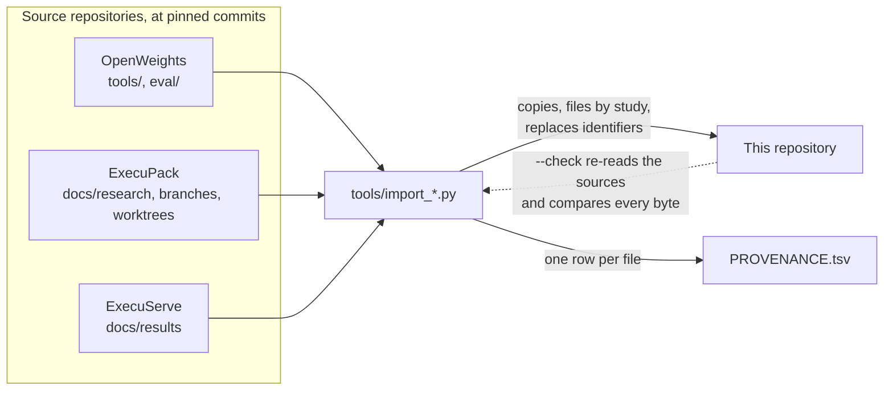

# How this repository was built

Every run file, script and write-up under `openweights/`, `execupack/` and `execuserve/` came from
one of three source repositories (or from a named folder on the maintainer's Mac, for work that
was never committed), and each says where it came from. The pages you read (the READMEs and
`docs/`), the charts and `tools/` were written here. A run recorded here directly, rather than
imported, is listed in its project's `ADDED.tsv`. This page explains how the imports work, so you
can judge how far to trust what you read.



## Nothing was copied by hand

`tools/import_<project>.py` reads each source at a pinned commit, places each file in its study,
and writes one row per file to `<project>/PROVENANCE.tsv`: the source path, the commit, the blob
it read, the blob it wrote, and whether the bytes changed on the way. The pinned commits are:

| Project | Source | Pinned at |
|---|---|---|
| OpenWeights | `tools/` and `eval/`, plus eight run files that were never committed | `81734dee` (17 Nov 2026) |
| ExecuPack | the `executorch-1.6` branch, three experiment branches as patches, two worktrees and the archive of the EC2 export machines | `b5affc76` and others, each named in its row |
| ExecuServe | `docs/results/`, the uncommitted memory-limits study and the NPU study's export logs | `bfbfa853` |

To check that nothing has drifted:

```sh
for p in openweights execupack execuserve; do python3 tools/import_$p.py --check; done
python3 tools/check_links.py      # every relative link resolves
python3 tools/figures.py --check  # every chart matches the data it draws
```

`--check` reads the sources again (it needs the source checkouts on this machine), compares every
byte, and fails on any file that differs, any file here that no source accounts for, and any
imported file git does not track.

## The only ways bytes changed

Each is listed in the import script, and each changed file is a `changed` row in its project's
`PROVENANCE.tsv`.

1. **Moved paths, rewritten.** A path that moved is rewritten in prose and code so links and
   scripts still work. Data files are never rewritten.
2. **Exact edits.** A moved script that found its files by a relative path gets a listed edit, so
   it finds them again (for example, scripts now take the app checkout from `OPENWEIGHTS`).
3. **Redactions.** Wireless-debugging names, home-network addresses, device-cloud host names and
   addresses, and the EC2 archive's account and instance ids.
4. **Device logs cut to the app's lines.** The 100 Firebase Test Lab logcats were whole-device
   logs with network names, addresses and test accounts. `tools/logcat_filter.py` kept the app's
   own lines: 10.4 million lines became 61 thousand. The full logs stay in OpenWeights' history.
5. **Pseudonyms.** Every device serial a run record names (26 lab units), every Google Cloud
   project the cloud runs used, and two login addresses become a stable stand-in: `unit-`,
   `gcp-project-` or `account-` and six hex characters of a hash. One unit keeps one name across
   every file, so results still group by unit. `tools/serials.py` does it.

## What stayed in the source repositories, and why

<details>
<summary><b>OpenWeights</b></summary>

- The instrumented benchmarks and probes under `app/` and `core/` (`BenchmarkSuite`,
  `ThreadCountBenchmark`, `DecisionSuiteOnDeviceTest` and the rest): they compile against the
  engine. The harness here builds and runs them from an OpenWeights checkout.
- `docs/research/` and `docs/CONTEXT.md`: the app's code cites them, so the studies here link to
  them at the pinned commit.
- `tools/npu/` apart from the benchmarks and the multi-turn replay: it builds the runtime the app
  links. Its `build_pd_libs.sh` also compiles `cpu_forward_bench.cpp`, so that file is in both
  places until the script stops needing it.
- `tools/release`, `tools/hooks`, `tools/review`, `tools/executorch`, and the two test-image
  generators the instrumented tests use: product tooling.
- `tools/run_python_tests.sh` still runs the benchmark grader's tests in OpenWeights' CI.

</details>

<details>
<summary><b>ExecuPack</b></summary>

- `pipeline/`, its tests, `config/`, `requirements/` and CI: the product.
- `docs/PLAN.md`: a roadmap with run notes, not a record.
- The two measurement workflows (`probe-runner.yml`, `audit-published.yml`): a workflow only runs
  from `.github/`.
- The pipeline's code, README and config cite `docs/research` by path and finding number, so that
  folder stays there too until those citations point here.

</details>

<details>
<summary><b>ExecuServe</b></summary>

The app; `tools/execuserve`, the command-line driver the studies call; `tools/compat`, the API
conformance checks that ExecuServe's README sends people to (its `bench.py` and `soak.py` only
measure, but the phone runs call them from there); `tools/executorch`, which builds the runtime
the app ships; and `docs/ARCHITECTURE.md`, whose review log the Vulkan study links to.

</details>

## What did not come across

<details>
<summary><b>Left out on purpose</b></summary>

- **Model files**: weights, `.pte` files, GGUF files, tokenizers, Hugging Face downloads and
  caches. They are downloadable or rebuildable; each study names them instead.
- **OpenWeights' 2026-11-04 chat capture** (38 MB, never committed): a dump of the app's data
  from the phone (its databases, preferences and a full logcat) and screen frames for the
  website. It is personal data and site material, not a measurement.
- **Raw logcats** that OpenWeights' own `.gitignore` keeps out of git. They stay on the Mac.
- **The EC2 archive's 17 GB of GPTQ solves and its inventory** (account, instance, network and key
  records). Both stay in the archive folder on the Mac.
- **Working files**: classes unpacked from an AAR, an adb error log, compiled Python committed by
  mistake, solve and export working folders, vendor licence copies, the export machines' shell
  dotfiles. ExecuPack alone lists 2,397 such files, each as `# excluded` in its
  `PROVENANCE.tsv` with the reason.

</details>

## Known gaps

- OpenWeights has gained runs since its pinned commit (for example a 2026-11-20 emulator run).
  They arrive by moving the pin and rerunning the import, never by copying.
- An uncommitted "Run it yourself" section in one OpenWeights run README was not imported: every
  tracked file was read from the commit, not the working tree.
