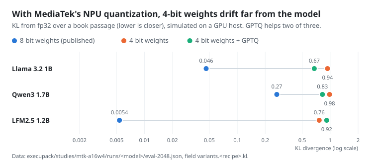

# MediaTek 4-bit weights (A16W4)

**How much accuracy MediaTek's 4-bit NPU recipe loses against the published 8-bit one, and
whether a GPTQ solve wins it back.**

`written up here` `1 machine` `19 Nov 2026`

> **The question.** On MediaTek's [NPU](../../../docs/glossary.md#npu), ExecuPack publishes
> models with 16-bit activations and 8-bit weights
> ([A16W8](../../../docs/glossary.md#a16w8-and-a16w4)). Those files do not load on a MediaTek
> MT6991 phone, and 4-bit weights (A16W4) would halve them. How far from the full-precision
> model is A16W4, which keeps one scale per row of weights with no groups, and does a
> [GPTQ](../../../docs/glossary.md#gptq) solve on that same grid close the gap enough to pass the
> [publish gate](../../../docs/glossary.md#decision-gate)?

> [!TIP]
> **What we found**
> - **A16W4 is far further from the full-precision model than A16W8 on every model, with or
>   without GPTQ.** [KL divergence](../../../docs/glossary.md#kl-divergence) over a held-out
>   book passage: Llama 3.2 1B 0.046 at 8-bit against 0.937 at 4-bit (0.675 with GPTQ), Qwen3
>   1.7B 0.266 against 0.985 (0.826), LFM2.5 1.2B 0.0054 against 0.762 (0.917).
> - GPTQ restores the tool-call decision on Llama (**12 of 12** gate rows) and Qwen3 (**11 of
>   12**) but not on LFM2.5 (8 of 12). The published 8-bit files themselves fail the gate on Llama
>   (7 of 12) and Qwen3 (9 of 12) in this harness.
> - Qwen3's floor is its 16-bit activations, not its weights: with 16-bit weights as well it
>   sits at KL 0.270, the same as at 8-bit. A 4-bit output head alone costs 0.02 to 0.05; the
>   decoder's linear layers carry the error.
> - The solve survives MediaTek's own quantizer exactly (**0** weights re-quantize to another
>   code), so MediaTek's export and runner need no change. None of these files has run on a
>   phone yet.

<picture>
  <source media="(prefers-color-scheme: dark)" srcset="../../../figures/mtk-a16w4-dark.svg">
  
</picture>

## Key numbers

| What | Result | Where |
|---|---|---|
| KL to fp32, 8-bit / 4-bit / 4-bit with GPTQ | 0.0462 / 0.9367 / 0.6745 | Llama 3.2 1B, 2,048 tokens, MediaTek's recipe simulated on a GPU host |
| The same | 0.2663 / 0.9849 / 0.8258 | Qwen3 1.7B |
| The same | 0.0054 / 0.7620 / 0.9166 | LFM2.5 1.2B |
| Publish-gate rows kept of 12, 8-bit / 4-bit / 4-bit with GPTQ | Llama 7 / 0 / **12**; Qwen3 9 / 1 / **11**; LFM2.5 12 / 0 / 8 | the same three models |
| Qwen3 with 16-bit weights too (A16W16) | KL 0.2704, gate 12 of 12 | Qwen3 1.7B |
| Weights that re-quantize to a different code after the solve | 0, on every layer and the head | all four models solved |
| 4-bit chunks against the published 8-bit ones | 758 against 1,375 MB; 1,105 against 1,963 MB; 642 against 1,225 MB | Llama, Qwen3, LFM2.5, built for MT6991 at 2,048 tokens |
| The GPU harness against the CPU, KL with GPTQ | 0.8048 on CUDA against 0.8138 on the CPU | SmolLM2 135M, 512 tokens |

## Why it matters

A16W8 stays the published recipe. The 4-bit files with GPTQ, whose chunks are 52 to 56 percent
the size of the 8-bit ones, wait for a load test on the MT6991 phone where the 8-bit files do not
load. For a developer: MediaTek's 4-bit grid is one scale per 2,048-wide row with no groups, far
coarser than the CPU recipe's groups of 32, where GPTQ passes the gate on all three models. On
this grid GPTQ rescues the tool-call decision on two of three models but brings general text
nowhere near 8-bit. And the full-precision embedding table the runner reads is the same size
either way: for Llama and Qwen3 it is about as large as all the 4-bit chunks together.

## What was tested

- **Machines.** One rented GPU pod, a RunPod A100 SXM 80 GB (32 vCPU, 250 GB); its export
  reports name the host CPU an AMD EPYC 7763. No phone ran these files. See
  [all devices](../../../docs/devices.md).
- **Runtimes.** [ExecuTorch](../../../docs/glossary.md#executorch) 1.5.1 with MediaTek's own
  export scripts, quantizer and [NeuroPilot](../../../docs/glossary.md#neuropilot) compiler. The
  quantization was simulated on the GPU, after a check against the CPU on SmolLM2 135M.
- **Models.** Llama 3.2 1B Instruct, Qwen3 1.7B and LFM2.5 1.2B Instruct; SmolLM2 135M for the
  CPU check.
- **Method.** Each model was built as MediaTek's export builds it (4 chunks, a 2,048-token
  [window](../../../docs/glossary.md#context-window)) and calibrated as the export calibrates.
  Held-out text (2,046 positions of a book from the PG19 set) was fed through the full-precision
  model and every variant; KL carries 95% block-bootstrap intervals. The 16 publish-gate prompts
  were put to every variant. The GPTQ solve pins each row's smallest and largest weight to the
  ends of the 4-bit range, so MediaTek's quantizer measures the same scale and returns the solved
  codes. The exports target MT6991 and passed the structural check.
- **When.** 19 November 2026.

## What's in this folder

| Run | What it holds |
|---|---|
| [`runs/llama/`](runs/llama/) | Llama 3.2 1B: the model plan, the 2,048-token evaluation of all three recipes, and the GPTQ solve's log with every layer's error. 6 files. |
| [`runs/qwen/`](runs/qwen/) | Qwen3 1.7B: the same, plus the 16-bit-weights (A16W16) diagnostic. 8 files. |
| [`runs/lfm/`](runs/lfm/) | LFM2.5 1.2B: the same, plus the 23-sample long-context calibration corpus its export uses. 7 files. |
| [`runs/smol/`](runs/smol/) | SmolLM2 135M at 512 tokens, evaluated on the CPU and on CUDA: the check that the GPU harness agrees. 7 files. |
| [`runs/status.log`](runs/status.log) | The pod's timeline from 04:53 to 05:17, with each evaluation's summary line. 1 file. |
| [`exports/`](exports/) | Each model's 4-bit export for MT6991: its export report, runner config and checksums (Llama's license too). The chunks and embeddings, 5 GB, stayed out. 10 files. |
| [`harness/`](harness/) | `mtk_gptq.py`, the GPTQ solve on A16W4's grid, and `mtk_quant_eval.py`, finding 35's evaluation harness generalised to several recipes. 2 files. |
| [`uncommitted.patch`](uncommitted.patch) | The worktree's edits to ExecuPack's tracked files. 1 file. |

`runs/` is the worktree's gitignored `work/a16w4/results/` and `exports/` comes from its
`work/a16w4/<model>/`, both text only. The evaluations are single-line JSON (`eval-*.json`): per recipe the KL, perplexity, top-1
agreement, every gate row and KL by position bucket. The `.log` files are console output, and
`gptq/gptq.json` lists each linear's error against plain rounding and its re-quantization
mismatches.

## Run it again

All of it was uncommitted in the `mtk-a16w4` worktree of ExecuPack on 19 November 2026.
`uncommitted.patch` is a plain diff against ExecuPack 34c55110, applied with `git apply` (not
`git am`); it adds the `MTK_WEIGHTS_FROM` hook to `pipeline/export_mtk.py` with its tests,
finding 49's row and a PLAN note. You also need MediaTek's Python 3.10 tool environment with
`mtk_converter` and the NeuroPilot Express SDK (licensed, never committed anywhere), a copy of
ExecuTorch's `examples/mediatek`, the Hugging Face weights (Llama is gated), the book text, and
ideally a CUDA GPU (Qwen3's export peaked at 92,313,632,768 B of resident memory). Model files are not in
this repository.

```sh
cd <execupack checkout at 34c55110>
git apply <experiments>/execupack/studies/mtk-a16w4/uncommitted.patch
# The docstrings call the two harness files scripts/mtk_gptq.py and scripts/mtk_quant_eval.py;
# the patch does not add them, so run them from this study's harness/ folder
H=<experiments>/execupack/studies/mtk-a16w4/harness

# GPTQ on A16W4's grid, written back as a checkpoint MediaTek's export reads unchanged
PYTHONPATH=<repo> /opt/awq/bin/python $H/mtk_gptq.py --hf <hf download> \
    --mtk-weights <export's weights dir> --out <dir>

# KL and gate of each recipe against fp32, from a copy of examples/mediatek
# (these runs added --device cuda; EXECUPACK and THREADS are read from the environment)
# It reads the current directory as examples/mediatek, so run it in a subshell
(cd <examples/mediatek> && PYTHONPATH=<repo> /opt/mtk-venv/bin/python $H/mtk_quant_eval.py \
    --script qwen.py --weights W --chunks 4 --window 2048 --dataset aot_utils/llm_utils/prompts/alpaca.txt \
    --preformatter aot_utils/llm_utils/preformatter_templates/qwen3.json --book pg25773.txt \
    --variant a16w8=A16W8 --variant a16w4=A16W4 --variant a16w4-gptq=A16W4:W_GPTQ --out result.json)

# The 4-bit export with the solved weights, from the ExecuPack checkout
cd <repo> && MTK_PRECISION=A16W4 MTK_WEIGHTS_FROM=<solve> python -m pipeline export-mtk <model> --soc MT6991 --context 2048
```

## Caveats

> [!NOTE]
> - Everything here was measured by simulating MediaTek's quantization on a host. The 4-bit
>   exports load, carry both methods and delegate to the NPU backend, but none has run on a
>   phone.
> - Finding 49 and its write-up were never committed to ExecuPack; they exist only in this
>   repository.
> - On LFM2.5, GPTQ made the book KL worse than plain 4-bit (0.917 against 0.762) while keeping
>   more gate rows (8 of 12 against 0).
> - The CUDA runs were within about 1 to 3 percent of the CPU's KL on SmolLM2, with the same
>   ordering and gate verdicts except one plain-rounding row (1 of 4 against 0 of 4).
> - The first Qwen3 export failed and was rerun; the write-up's "Found on the way" explains a
>   virtualenv symlink bug that made exports refuse until it was fixed.

## Read more

- Write-up here: [A16W4 on MediaTek, with and without GPTQ on MediaTek's own grid](../../research/evidence/mtk-a16w4-gptq.md),
  and finding 49 in the [research log](../../research/README.md).
- The harness this generalises, finding 35's:
  [`mtk-calibration-and-precision-ab.py`](../../research/evidence/mtk-calibration-and-precision-ab.py)
  and its [output](../../research/evidence/mtk-calibration-and-precision-ab.txt).
- Related: [AWQ beside GPTQ](../awq/) (the same models on the CPU recipe) and the
  [harness](harness/) folder.
- Words used here: [glossary](../../../docs/glossary.md).
