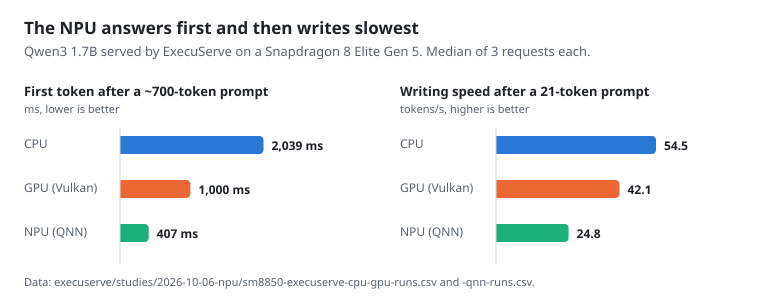

# ExecuServe experiments

**The measurements behind [ExecuServe](https://github.com/ExperimentalMachines/execuserve), an
Android app that serves ExecuTorch models to other apps on the phone.**

`5 studies` `3 phones, 1 emulator` `Sep to Nov 2026`

ExecuServe runs [`.pte`](../docs/glossary.md#pte) model files on the phone and answers other apps
through local HTTP endpoints that speak the OpenAI and Anthropic APIs. It runs as a foreground
service so it keeps answering with the screen off, offers each phone only the CPU, GPU or NPU
build its hardware can run, and caches each conversation so a follow-up does not re-read the whole
prompt. These studies checked each of those promises on real phones.

## What we found

> [!TIP]
> - **Cached follow-ups are an order of magnitude faster.** On the POCO X8 Pro Max the second turn
>   of a 2,077-token conversation answered in **0.47 s** against 8.36 s for the cold first turn,
>   with 2,088 of 2,106 prompt tokens served from the cache.
> - **The NPU wins the first token and loses the stream.** On a Snapdragon 8 Elite Gen 5,
>   Qualcomm's NPU read a ~700-token prompt about five times faster than the CPU, but after a short
>   21-token prompt it wrote at half the CPU's speed. It pays for long prompts with short answers.
> - **"The GPU is faster" depends on the GPU.** On the POCO's Mali-G925 the CPU build decoded
>   2.2 to 3.9 times faster than the Vulkan GPU build; on the Snapdragon 8 Elite Gen 5's Adreno the
>   GPU won after a long prompt and lost after a short one.
> - **Android 17's background memory caps can make a model that loads unusable.** With a 6 GB
>   phone's 2 GiB cap applied by hand, Qwen3 4B decoded at 1.0 to 1.2 tokens/s instead of 25 to 26,
>   and the app's own admission check still allows it.
> - **On HyperOS the foreground service is what keeps the server reachable in Doze**, until the user
>   sets battery use to "Restricted", which stopped the service.

<picture>
  <source media="(prefers-color-scheme: dark)" srcset="../figures/npu-serving-dark.svg">
  
</picture>

## Studies

Each study is a write-up with an evidence folder of the same name beside it, the layout
ExecuServe itself uses.

| Study | The question | What we found | Evidence |
|---|---|---|---|
| [First run on the POCO X8 Pro Max](studies/2026-09-29-poco-x8-pro-max.md), Sep 2026 | Does the server work on a real phone, and stay reachable with the screen off? | The OpenAI SDK suite passed 15 of 15 for two models; follow-ups in 0.47 s; 20 of 20 requests answered in a 10-minute screen-off soak | none: the figures came from ExecuServe's own conformance checks |
| [Vulkan GPU exports on three phones](studies/2026-10-04-vulkan.md), Oct 2026 | Can it serve on the GPU, and is that faster? | Served correctly on all three GPUs; on the POCO's Mali the CPU build is faster, on the Snapdragon 8 Elite Gen 5 the GPU won only after a long prompt | [`2026-10-04-vulkan/`](studies/2026-10-04-vulkan/) |
| [NPU exports on two phones](studies/2026-10-06-npu.md), Oct 2026 | Can it serve on Qualcomm's and MediaTek's NPUs, and how do they compare? | Qwen3 1.7B ran on Qualcomm's NPU after five runner defects were patched: 407 ms first token after a ~700-token prompt, half the CPU's writing speed after a short one | [`2026-10-06-npu/`](studies/2026-10-06-npu/) |
| [Android 17's memory limits, by hand](studies/2026-11-04-memory-limits.md), Nov 2026 | What do the coming background memory caps do to served models? | Never killed in 12 runs, but the two tightest caps filled swap and slowed the model until it was unusable | [`2026-11-04-memory-limits/`](studies/2026-11-04-memory-limits/) |
| [ExecuTorch 1.6.0](studies/2026-11-13-executorch-1.6.0.md), Nov 2026 | Does the runtime upgrade change answers, speed or compatibility? | No measured regression, same cache reuse, no crashes; it shipped | [`2026-11-13-executorch-1.6.0/`](studies/2026-11-13-executorch-1.6.0/) |

Each evidence folder's `codex/` subfolder holds the adversarial reviews of its write-up, kept
verbatim. In the Vulkan study they narrowed the verdict to one model on one GPU and corrected
ratios without reversing anything; in the ExecuTorch 1.6.0 study they led to three fixes and a list
of five older open defects.

> [!NOTE]
> - The NPU study's "greedy" runs probably were not: the 1.6.0 review found that the patched
>   Qualcomm runner ignores the request's temperature, and that it could still abort on a prompt
>   ending in the window's last prefill block. Both were "in 1.5.1 as well".
> - The memory-limits study applied Android 17's caps by hand on Android 16; the limiter itself
>   never ran, so whether Android 17 would also end the app is untested.
> - The Vulkan session is the same one OpenWeights recorded in its
>   [Vulkan study](../openweights/studies/vulkan/), which keeps a byte-identical copy of the 14
>   ExecuServe files. This write-up covers the server; OpenWeights' covers the engine.

## Running a study again

The phone scripts take ExecuServe's checkout from `REPO_ROOT` and the phone's adb serial from
`SER`; `memtest.py` reads `SER` too. Each phone run writes a `start.txt` holding the session's API
key, which `.gitignore` refuses: never commit it.

```sh
export REPO_ROOT=~/path/to/execuserve
export SER=<adb serial>
```

Kept exactly as it ran: `2026-11-13-executorch-1.6.0/phone/run.sh` and `run2.sh` call
`$HERE/greedy.py`, which is in `../emulator/`, so copy it beside them before running. Some reruns
also need export files or sender scripts that were not kept; each write-up's method section names
what it used. Model files are not in this repository.

## Where these files came from

Imported from ExecuServe's `docs/results/` at commit `bfbfa853` by `tools/import_execuserve.py`.
The memory-limits study was never committed to ExecuServe and came from the working tree; the NPU
study's export logs, reports and configs (Qwen3 1.7B at 4k and SmolLM2 135M at 512) came from the
export folder on the Mac, without the `.pte` files and tokenizers. In the Vulkan session's logs,
device-cloud addresses and host names were redacted and the unit's serial became its pseudonym.
Every file has a row in [`PROVENANCE.tsv`](PROVENANCE.tsv); see also
[how this repository was built](../docs/provenance.md).
