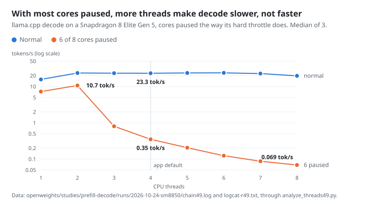

# Prefill and decode on CPU, GPU and NPU

**Which processor should read the prompt and which should write the reply, and what heat and the
thread count do to how fast a phone answers.**

`written up in OpenWeights, in part` `9 phones` `24 Oct to 18 Nov 2026`

> **The question.** A phone's chip has three processors that can run a model: the CPU, the GPU
> and an [NPU](../../../docs/glossary.md#npu). Every turn of a chat has two halves,
> [prefill and decode](../../../docs/glossary.md#prefill-and-decode): reading the prompt, then
> writing the reply. Which processor should do each half over real multi-turn conversations, on
> Snapdragon and on MediaTek? And what do [thermal throttling](../../../docs/glossary.md#thermal-throttling)
> and the number of CPU threads do to the reply's speed?

The study has two parts. The Snapdragon matrix (October and early November) is written up in
OpenWeights. The cross-vendor runs (mid November) are not written up yet; their run notes are the
record.

> [!TIP]
> **What we found: the Snapdragon matrix (written up)**
> - On a Snapdragon 8 Elite Gen 5 the NPU read prompts **10.5 to 15.9 times** as fast as the CPU
>   on all nine models. At the conversations' real reply lengths, NPU prefill was in the fastest
>   pairing on every model (73% to 86% of CPU-only time), and the GPU never won at writing the
>   reply.
> - **On a throttled phone, more threads were far slower.** When the hard throttle paused six of
>   eight cores, the app's llama.cpp engine at its default 4 threads fell to **0.24 tok/s**
>   against 23.12 unpaused, while 2 threads kept 46%. Idle worker threads spin on the two cores
>   the working threads need.
> - A stall guard that drops to 2 threads after two slow steps wrote **3.21 to 3.37 tok/s** through
>   a held pause, against 0.57 to 0.61 without it.
> - Every run was a root shell on rack phones, so nothing here shows an NPU split working inside
>   an ordinary app.

> [!IMPORTANT]
> **Not written up yet: the cross-vendor runs**
> - These results are unpublished. They come from the run notes and their reviews, and the notes
>   say the runs "cannot separate why" one device beat the other: core mix, runtimes, heat and
>   memory all differ.
> - On a Galaxy S24 Ultra the NPU read prompts at a median **8.60 times** that phone's own CPU; on
>   a Galaxy Tab S10+ (Dimensity 9300+) it read them at 0.86 times its CPU. Yet the tablet
>   finished all turns first on **8 of 9** models, mostly on its CPU alone.
> - Neither device showed a core going offline or a decode step over 500 ms in 2.5 hours of
>   forced heating, though the S24 Ultra lost 43% of its 6-thread CPU prompt reading.
> - MediaTek's NPU path had two defects: its stock runner lacks Llama 3's position scaling, so
>   long replies drift into word salad (fixed in the bench), and Qwen3's first token after NPU
>   prefill never matched the CPU's (still open). Exynos 2400, Tensor G5 and Tensor G6 NPUs are closed to an unrooted shell.

<picture>
  <source media="(prefers-color-scheme: dark)" srcset="../../../figures/threads-under-throttle-dark.svg">
  
</picture>

## Key numbers

### The Snapdragon matrix (written up)

| What | Result | Where |
|---|---|---|
| NPU prompt reading against the CPU | 10.5 to 15.9 times the CPU, 5.1 to 8.2 times the GPU | Snapdragon 8 Elite Gen 5, nine models, llama.cpp's Hexagon backend |
| Best pairing at the conversations' reply lengths | NPU prefill in the fastest cell on every model, 73% to 86% of CPU-only; GPU decode 111% to 224% on eight models | the same phone, with the soft throttle on |
| Decode with six of eight cores paused | 4 threads (the default): **0.24** against 23.12 tok/s; 2 threads: 10.57 against 22.91 | Snapdragon 8 Elite Gen 5, Qwen3 4B, the app's engine on llama.cpp v0.8.0 |
| Every thread count, paused (the chart) | 2 threads 10.70 tok/s, 4 threads 0.351, 8 threads 0.069; unpaused 23.29 at 4 | the same, a 19-token prompt |
| A 1,751-token prompt in a pause | 4 threads kept 2.8% of decode speed, 2 threads 37% and 38% | Snapdragon 8 Elite Gen 5, Qwen3 4B |
| The stall guard through a held pause | **3.21 to 3.37 tok/s** with it, 0.57 to 0.61 without | Snapdragon 8 Elite Gen 5, Qwen3 4B, 1,751-token prompt |
| The guard's early return after a pause ends | 0.3 and 0.4 s with the early try, 13.8 s on the 30 s schedule alone | Snapdragon 8 Gen 2, Qwen3 4B |

### The cross-vendor runs (not written up)

| What | Result | Where |
|---|---|---|
| NPU prompt reading against the same phone's CPU, median of 8 models | **8.60x** (S24 Ultra) against 0.86x (Tab S10+) | S24 Ultra: llama.cpp's Hexagon backend; Tab S10+: MediaTek's NPU through ExecuTorch |
| NPU reply writing against the same phone's CPU | 0.9395 to 1.1717x (S24 Ultra); 0.1451 to 0.3384x (Tab S10+) | the same |
| Which device finished all turns first, each on its fastest pairing | Tab S10+ on 8 of 9 models; the S24 Ultra only on Llama 3.2 3B, 630.6 s against 638.9 s | 9 GGUF models, 19 to 24 turns each |
| 2.5 hours of forced heating, CPU at 6 threads | S24 Ultra prompt reading 336 to 192 tok/s, decode 24.7 to 22.3; Tab S10+ 306 to 284 and 40.6 to 39.5 | Gemma 3 1B, llama.cpp CPU |
| Llama 3 on MediaTek's NPU, key cache against the CPU (cosine) | 0.999 at positions 0 to 255, 0.91 past 1,280; 0.993 to 1.000 after the fix | Tab S10+, Llama 3.2 1B |
| Qwen3's first token after NPU prefill matching the CPU's | 0 of 69 (0.6B), 0 of 25 (1.7B); 0 of 23 with nine calibration prompts instead of two | Tab S10+ |
| NPU memory at a 4k window | 6.8 GB of kernel memory, 0.58 GB left; a GPU copy beside it panicked the kernel twice | Tab S10+, Qwen3 0.6B |

## Why it matters

The thread finding changed the engine: OpenWeights now carries a stall guard that falls back to
2 threads after two slow decode steps and tries the planned count again later, though it is not in
a Play release yet. No NPU split ships, because nothing was tested from an app's own sandbox. For
anyone running llama.cpp on phones: the thread count that is fastest on a cool phone can be the
slowest by two orders of magnitude when the system takes cores away, and the thread affinity the
app can read does not show it, so watch decode step times. And an NPU is not a free speedup: on
the Dimensity 9300+ it was slower than the CPU at both halves, so measure the pairing per chip and
runtime.

## What was tested

- **Phones.** Written up: Qualcomm reference handsets with a Snapdragon 8 Elite Gen 5 (SM8850),
  several units, and one Snapdragon 8 Gen 2 (SM8550), all on
  [Qualcomm Device Cloud](../../../docs/glossary.md#qualcomm-device-cloud-qdc) with a root shell;
  the POCO X8 Pro Max (MediaTek MT6991), the maintainer's own phone. Not written up, all unrooted:
  a Galaxy S24 Ultra (Snapdragon 8 Gen 3), 10 units, and a Galaxy Tab S10+ (MediaTek Dimensity
  9300+), 8 units, on [Firebase Device Streaming](../../../docs/glossary.md#firebase-device-streaming);
  a Galaxy Tab S12+ (MediaTek MT6993, Dimensity 9500) on
  [Samsung Remote Test Lab](../../../docs/glossary.md#samsung-remote-test-lab-rtl); NPU access
  checks on a Galaxy S24+ (Exynos 2400), a Pixel 10 Pro XL (Tensor G5) and a Pixel 11 (Tensor G6).
  See [all devices](../../../docs/devices.md).
- **Runtimes.** [llama.cpp](../../../docs/glossary.md#llamacpp) b10549 with its CPU, OpenCL (Adreno
  GPU) and Hexagon (NPU) backends; the app's own engine on llama.cpp v0.8.0 for the thread and
  throttle runs; [ExecuTorch](../../../docs/glossary.md#executorch) 1.5.1 with
  [QNN](../../../docs/glossary.md#qnn) for one NPU comparison. On the tablet, llama.cpp on the CPU
  and on Vulkan, and the NPU through ExecuTorch 1.6.0 with [NeuroPilot](../../../docs/glossary.md#neuropilot)
  exports in [A16W8 and A16W4](../../../docs/glossary.md#a16w8-and-a16w4).
- **Models.** Qwen3 0.6B, 1.7B and 4B, Gemma 3 1B, Llama 3.2 1B and 3B, LFM2.5 1.2B and 2.6B, as
  4-bit GGUF files (Qwen3 1.7B also at 8 bits).
- **Method.** Nine real conversations (three each from WildChat-1M, UltraChat 200k and
  Daring-Anteater), 33 turns, replayed turn by turn with the dataset's own earlier replies so every
  pairing reads identical tokens; 6 threads, [greedy](../../../docs/glossary.md#greedy-decoding),
  a cooling gate before each pairing. The thread work ran the app's engine on a 19-token and a
  1,751-token prompt, with the throttle set by hand or brought on by heat. The cross-vendor runs read
  only the turns that fit a 2,048-token window (23 or 24 of the 33).
- **When.** 24 October to 11 November 2026 (written up); 15 to 18 November 2026 (cross-vendor).

## What's in this folder

| Run | What it holds |
|---|---|
| [`runs/2026-10-24-sm8850/`](runs/2026-10-24-sm8850/) | Written up. The Snapdragon 8 Elite Gen 5 matrix and every follow-up round on QDC: the nine pairings, reply lengths, ExecuTorch QNN, the throttle ladder, the app's engine in a pause, the stall guard, chat sessions and every thread count. 733 files. |
| [`runs/2026-11-09-poco-mt6991/`](runs/2026-11-09-poco-mt6991/) | Written up. The stall guard and ordinary chat against the throttle on the POCO; the energy-per-token run that never started. 40 files. |
| [`runs/2026-11-10-sm8550/`](runs/2026-11-10-sm8550/) | Written up. The stall guard's retry schedule on a Snapdragon 8 Gen 2. 36 files. |
| [`runs/2026-11-11-sm8850-r52/`](runs/2026-11-11-sm8850-r52/) | Written up. Every thread count on a 1,751-token prompt, normally and in a pause. 54 files. |
| [`runs/2026-11-16-s24/`](runs/2026-11-16-s24/) | Not written up. The matrix and heat probes on the Galaxy S24 Ultra, unrooted, with its `NOTES.md`, session ledger and eight Codex reviews. 543 files. |
| [`runs/2026-11-16-mt6989/`](runs/2026-11-16-mt6989/) | Not written up. The matrix on the Galaxy Tab S10+ with the NPU through MediaTek's runtime, heat, memory, the Llama 3 and Qwen3 checks, `NOTES.md` and its ledger. 481 files. |
| [`runs/2026-11-18-mt6993-pilot/`](runs/2026-11-18-mt6993-pilot/) | Not written up. The Galaxy Tab S12+ (Dimensity 9500) pilot on Samsung Remote Test Lab. It was never committed to OpenWeights; it came from the working tree. 4 files. |
| [`runs/npu-access/`](runs/npu-access/) | Whether a retail Exynos or Tensor unit's shell can reach its NPU. 17 files. |

Turn records are `results-*.jsonl`, one JSON object per measured turn. `inst-*.txt` is the app's
instrumentation output, `place-*.txt` samples which core each thread ran on, `chain*.sh` are the
phone-side scripts exactly as they ran, and `analysis-*.md` and `NOTES.md` are the notebooks written
at the time. The `unit` in every row and log names the physical phone by a
[pseudonym](../../../docs/glossary.md#unit-pseudonym) (`unit-` and six hex digits) instead of its
serial; one unit has one name across all runs.

## Run it again

The Snapdragon matrix needs a QDC reservation with a root shell, an x86_64 Linux host with Docker
for Qualcomm's toolchain image, an OpenWeights checkout (for its vendored llama.cpp and the engine
test APK), and the models from Hugging Face. The cross-vendor runs need a Google Cloud project with
Device Streaming and billing (sessions are paid by the minute), `uv`, `adb` and `gcloud`; the
tablet's NPU bench also needs an x86_64 Linux host with MediaTek's NeuroPilot Express SDK, and the
pilot a Samsung Remote Test Lab booking. The built binaries, the GGUF files and the NPU exports are
not in this repository.

```sh
export OPENWEIGHTS=~/path/to/openweights

# The Snapdragon matrix: build pd_bench and llama.cpp's three backends with the Docker command in
# openweights/harness/prefill-decode/snapdragon/README.md, push them, then on the phone:
BIN=pd_bench COOL=55 COOL_MAX=300 nohup sh run_matrix.sh r4 1 \
  Llama-3.2-1B-Instruct-Q4_0.gguf Qwen3-4B-Q4_0.gguf:HTP0,HTP1 > run-r4.out 2>&1 &
# and on the Mac
python3 openweights/harness/prefill-decode/snapdragon/analyze_pd.py results-r4.jsonl \
  --conversations openweights/harness/prefill-decode/snapdragon/conversations.jsonl

# The chart's table, from the stored thread-count run
(cd openweights/studies/prefill-decode/runs/2026-10-24-sm8850 && \
  python3 ../../../../harness/prefill-decode/snapdragon/analyze_threads49.py table chain49.log logcat-r49.txt .)

# Cross-vendor: one Galaxy Tab S10+ session, then one Galaxy S24 Ultra session, on Device Streaming.
# Each session writes its results and ledger.tsv into RES, which must be a new run folder: the
# archived 2026-11-16 folders are records.
RES=$PWD/openweights/studies/prefill-decode/runs/<yyyy-mm-dd>-<what> PORT=5599 \
  openweights/harness/prefill-decode/mediatek/session.sh <label> <queue file> <warm-up gguf|-> <hot-probe gguf|->
RES=$PWD/openweights/studies/prefill-decode/runs/<yyyy-mm-dd>-<what> DEVICE=e3q \
  openweights/harness/prefill-decode/snapdragon/session_sd.sh <label> <queue file> <warm-up gguf|-> <hot-probe gguf|->
python3 openweights/harness/prefill-decode/mediatek/analyze_mtk.py <results.jsonl> ...

# Can a retail phone's shell reach its NPU?
openweights/harness/device-streaming/check_npu.sh <label> <model id> <android version> <port>
```

`session.sh` expects the GGUF files, NPU exports and bench under `~/ow-models/` and reserves a
`gts10pwifi` for three hours. The queues the sessions ran are `q-s4.txt` to `q-s16.txt` and
`q-s24a.txt` to `q-s24o.txt` in the harness. The Dimensity 9500 pilot has no driver script: the
tablet's bench was run by hand over the lab's remote debug bridge.

## Caveats

> [!NOTE]
> - The cross-vendor comparison is not like for like. The two NPUs ran different runtimes and
>   different [quantizations](../../../docs/glossary.md#quantization), so each ratio is that NPU
>   against its own CPU, not one NPU against the other. On the tablet every NPU-read Qwen3 turn
>   ended at its first token, so its Qwen3 0.6B NPU result is fixed work, not a real reply.
> - The tablet's 0.86x median was computed with the first Llama 3.2 1B session, whose NPU replies
>   drifted; with the rerun in its place the same median is 0.85x (recomputed for this page).
> - The tablet notes say the Snapdragon 8 Elite Gen 5's 0.24 tok/s was at 6 threads. The
>   written-up table gives 0.24 at 4 threads and 0.083 at 6; the table is the measurement.
> - The guard's held-pause figure leaves out two runs the write-up judged to be pauses that did not
>   hold; the analysis script, which keeps one of them, reports a median of 5.29 tok/s.
> - Two threads cost little outside a pause on a short prompt (within 3.2% of 4), but decoded 11%
>   slower on the 1,751-token prompt on the Snapdragon 8 Elite Gen 5 and about 29% slower on the POCO.
> - The S24 Ultra heat runs reached Android's critical thermal status, and a shell cannot read the
>   core-pause switches, so a pause there is not excluded. Energy per token was never measured: QDC's
>   power rails read zero and the POCO run did not start.
> - The S24 Ultra notes name a pilot file, `probe-s24.jsonl`, that is not in the folder.

## Read more

- Write-up in OpenWeights: [Prefill and decode on CPU, GPU and NPU: every pairing on a Snapdragon 8 Elite Gen 5](https://github.com/ExperimentalMachines/openweights/blob/81734deed5048f5691518d0e739662c50e51e1a3/docs/research/snapdragon-pd-matrix.md)
- The cross-vendor record: [Galaxy S24 Ultra notes](runs/2026-11-16-s24/NOTES.md),
  [Galaxy Tab S10+ notes](runs/2026-11-16-mt6989/NOTES.md),
  [Dimensity 9500 pilot notes](runs/2026-11-18-mt6993-pilot/NOTES.md).
- Related: [prefix reuse](../prefix-reuse/) (why a real turn prefills so little) and
  [runtime upgrades](../runtime-upgrades/); does NPU prefill pay on real conversations, in the
  [harness README](../../harness/README.md#does-npu-prefill-pay-on-real-conversations).
- Harness: [`harness/prefill-decode/`](../../harness/prefill-decode/) (`snapdragon/` and
  `mediatek/`), and [`harness/device-streaming/`](../../harness/device-streaming/) for the Device
  Streaming units.
- Words used here: [glossary](../../../docs/glossary.md).
