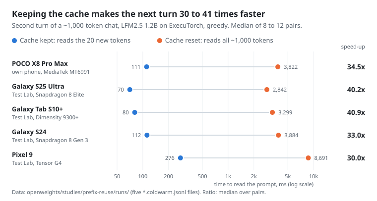

# Prefix reuse

**What keeping the conversation's cache saves on the next turn, and when it silently stops
working.**

`written up in OpenWeights, in part` `5 phones` `15 to 16 Nov 2026`

> **The question.** A chat app can keep the model's memory of the conversation so far (its
> [KV cache](../../../docs/glossary.md#kv-cache)) instead of rebuilding it every turn. How much
> faster does the next turn start on real phones, on both runtimes OpenWeights ships? And does
> the next turn still reuse that memory when the previous reply ended badly: cut off by a token
> budget, cancelled, or followed by an edit to earlier text?

> [!TIP]
> **What we found**
> - Keeping the cache made a ~1,000-token second turn start **30 to 41 times faster** on every
>   phone tried: 111 ms instead of 3,822 ms on the POCO X8 Pro Max. Across four model families
>   and both runtimes, 224 of 224 second turns reused the first.
> - **How the last reply ended decides whether reuse happens.** ExecuTorch reuses the cache only
>   after a clean end and re-reads everything after a budget cut, a cancel or an edit. llama.cpp
>   kept a cut or cancelled reply, and rolled back to the point of an edit.
> - Two silent failures were found and explained. A Qwen3 export ends replies on token 0 (`"!"`),
>   and MediaTek's NPU runner never reported its stop token. With the second fixed in the app, a
>   second turn on the NPU went from 11,671 ms to 441 ms.

<picture>
  <source media="(prefers-color-scheme: dark)" srcset="../../../figures/prefix-reuse-dark.svg">
  
</picture>

## Key numbers

| What | Result | Where |
|---|---|---|
| Second turn, cache kept against cache reset | **111 ms** (20 new tokens) against **3,822 ms** (1,003 tokens), 34.5x; same reply 8 of 8 | POCO X8 Pro Max, LFM2.5 1.2B, ExecuTorch |
| The same test on four Test Lab phones, 12 pairs each | 30.0x (Pixel 9) to 40.9x (Galaxy Tab S10+); 48 of 48 pairs reused | Galaxy S24, Galaxy S25 Ultra, Pixel 9, Galaxy Tab S10+ |
| A fresh chat over a restored snapshot of the fixed prompt head | 238 ms against 7,068 ms, 29.8x | POCO, LFM2.5 1.2B, llama.cpp v0.8.0 |
| Qwen3 on llama.cpp keeps only part of the cache | 2.8x to 3.1x: its chat template drops past reasoning, so 349 tokens are re-read | Galaxy S24 and S25 Ultra, Qwen3 1.7B |
| Sampled Qwen3 second turns that re-read everything | 25 of 75; every miss followed a reply that ended on token 0 (`"!"`) | four phones, Qwen3 1.7B INT8-INT4, ExecuTorch |
| MediaTek NPU, second turn time to first token | 11,671 ms as shipped (0 of 8 reused) against **441 ms** with the fix (8 of 8); a reset cache took 5,662 to 5,952 ms | POCO, LFM2.5 1.2B, NPU prefill with CPU decode |
| The same phone on its CPU alone | 85 ms kept against 3,312 ms reset (39.0x), faster than the NPU both ways | POCO, LFM2.5 1.2B, XNNPACK |
| Tokens the second turn read after a budget cut | ExecuTorch 938 (a full re-read, 3,076 ms) against llama.cpp 28 (151 to 170 ms) | Galaxy S25 Ultra |

## Why it matters

Keeping the cache between turns is the largest single latency lever these studies measured. But
the saving rests on bookkeeping: the app has to know exactly how each reply ended and what the
runtime kept, and a compiled model has to declare its end tokens. When either is wrong, reuse
quietly becomes a full re-read, and nothing reports an error; the turn is just ten to forty times
slower. The NPU finding became an engine change in OpenWeights (commit `3f1aab51`): a reply that
MediaTek's runner ended on its own stop token now keeps its cache record.

## What was tested

- **Phones.** The POCO X8 Pro Max (MediaTek MT6991, the maintainer's own phone); on Firebase Test
  Lab a Galaxy S24 (Snapdragon 8 Gen 3), a Galaxy S25 Ultra (Snapdragon 8 Elite), a Pixel 9
  (Tensor G4) and a Galaxy Tab S10+ (Dimensity 9300+); a second Galaxy Tab S10+ through Firebase
  Device Streaming. A Mac (Apple M5) rebuilt the Qwen3 divergence offline. See
  [all devices](../../../docs/devices.md).
- **Runtimes.** ExecuTorch 1.6.0 (the app's build of it) on the CPU (XNNPACK), the GPU (Vulkan),
  Qualcomm's NPU (QNN) and MediaTek's NPU (NeuroPilot); llama.cpp v0.8.0.
- **Models.** LFM2.5 1.2B, Qwen3 1.7B, Llama 3.2 1B and 3B, Gemma 3 1B, LFM3 1.7B, LFM2.5 2.6B and
  Gemma 3n E2B, as compiled `.pte` exports and as GGUF files.
- **Method.** OpenWeights' instrumented engine tests read the same second turn twice, once with
  the cache kept and once reset, alternating which came first, with the phone cooled to 45 °C
  before each pair and the screen on. The reuse-boundary runs end the first reply four ways and
  count what the second turn re-reads.
- **When.** 15 and 16 November 2026.

## What's in this folder

| Run | What it holds |
|---|---|
| [`runs/2026-11-15-coldwarm-poco/`](runs/2026-11-15-coldwarm-poco/) | The first cold and warm runs on the POCO (greedy and sampled, ExecuTorch and llama.cpp), the same on a Galaxy S24 and S25 Ultra, and the scripts that ran and summarised them. 37 files. |
| [`runs/2026-11-16-coldwarm-matrix/`](runs/2026-11-16-coldwarm-matrix/) | The order-balanced matrix on four Test Lab phones; CPU, GPU and NPU for one model; four families on both runtimes; the MediaTek NPU before and after the fix; and `qwen3-divergence/`, the Mac reconstruction of why Qwen3's warm and cold replies differ. 174 files. |
| [`runs/2026-11-16-reuse-boundary/`](runs/2026-11-16-reuse-boundary/) | The second turn after a clean end, a budget cut, a cancel and an edit, on ExecuTorch and llama.cpp, Galaxy S25 Ultra. 9 files. |

Each run folder has its own README: the lab notebook of that run, with every table, written
when it ran. Rows are `*.jsonl` (one JSON object per measured turn), the device's log lines are
`*.log`, and the `.sh` and `.py` files beside them are the exact scripts that produced them.

## Run it again

You need an OpenWeights checkout, its engine test APK built with
`./gradlew :core:engine:assembleDebugAndroidTest -Pow.testJniOnDisk=true`, and the model files
staged on the phone under `/data/local/tmp/openweights/`. Models are not in this repository.

```sh
export OPENWEIGHTS=~/path/to/openweights
cd openweights/studies/prefix-reuse/runs

# Same prompt, cache kept and reset, on a phone over adb (greedy, LFM2.5 only)
S=<adb serial> ONLY=lfm EXTRA="-e temperature 0 -e coolLimitS 60" 2026-11-15-coldwarm-poco/run.sh
python3 2026-11-15-coldwarm-poco/report.py <stem>.coldwarm.jsonl

# A fresh chat over a restored snapshot, llama.cpp
S=<adb serial> G=<gguf stem> 2026-11-15-coldwarm-poco/run_restore.sh

# One Firebase Test Lab phone (needs a Google Cloud project with Test Lab and a bucket)
ACCOUNT=... PROJECT=... BUCKET=gs://<folder> RAW=<dir outside the repo> APK=<test apk in the bucket> \
  2026-11-16-coldwarm-matrix/ftl.sh <device id> <tag> <test> <args> <files>
```

Each script prints its usage when run without arguments. The device ids used were `SC-51E`,
`pa3q`, `tokay` and `gts10pwifi`.

## Caveats

> [!NOTE]
> - Reuse is not always bit-identical to a fresh read: on some families the greedy reply changed
>   with the cache kept, and the same way on every chip. `qwen3-divergence/` traces why for Qwen3.
> - The Pixel 9 ran hot (53 to 74 °C) through its pairs.
> - The reset arm's token count in the rows (953) is the engine's estimate; the runtime's own
>   position was 1,003.
> - Only the two end-of-reply findings are written up in OpenWeights. The cross-chip ratios, the
>   four-family table and the reuse-boundary table exist only in the run READMEs here.

## Read more

- Write-up in OpenWeights: [How a reply ended decides whether the next turn reuses the cache](https://github.com/ExperimentalMachines/openweights/blob/81734deed5048f5691518d0e739662c50e51e1a3/docs/research/reply-end-and-reuse.md)
- Related: [on-device evals](../on-device-evals/) (where the warmed first turn was measured) and
  [runtime upgrades](../runtime-upgrades/).
- Words used here: [glossary](../../../docs/glossary.md).
